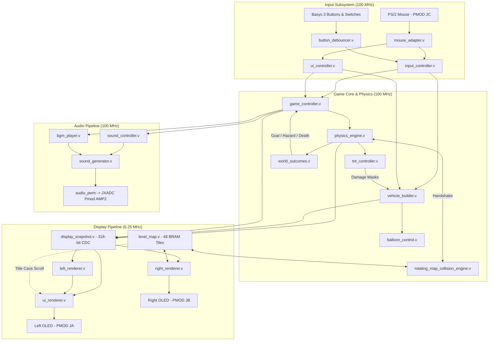

# Bad Piggies FPGA ("Laggy Piggies") — Hardware-Accelerated Physics & Dual-OLED Game Engine

-blue)

-orange)
-success)
-informational)


A complete hardware-accelerated clone of **Bad Piggies** built from scratch in Verilog/VHDL on the **Digilent Basys 3** (`XC7A35T-1CPG236C`) FPGA. The system features a real-time Q12.8 fixed-point rigid-body physics engine with 32-step vehicle rotation, Separating Axis Theorem (SAT) cave terrain collision, swept-AABB TNT explosions with cell-level damage masks, dual-voice PWM music synthesis, PS/2 mouse drag-and-drop construction, and a dual-screen 96×64 RGB OLED display pipeline.

---

## 1. Team Roles & Ownership — Lab Group S2-01 (GPT 6)

| Role | Student Name | Matriculation No. | Subsystems & Responsibilities |
| :--- | :--- | :--- | :--- |
| **Student A (Role 1)** | **Kaushal Rajesh** | `A0315560L` | Vehicle Builder (`vehicle_builder.v`), Inventory/Stock & Mounting Rules, PS/2 Mouse Drag-and-Drop (`mouse_adapter.v`, `ui_controller.v`), Audio Pipeline (`bgm_player.v`, `sound_generator.v`, `sound_controller.v`), 7-Segment Countdown Timer (`seven_seg_timer.v`), Left OLED UI Layouts (`ui_renderer.v`, `left_renderer.v`), Dual-OLED Diary Walkthrough & Settings `[ ? ]` Switch Guide |
| **Student B (Role 2)** | **Kyle Lee Yao Yu** | `A0322756B` | Rigid-Body Physics Engine (`physics_engine.v`), Newtonian Kinematics in Q12.8 Fixed-Point, 16-Cycle Restoring Signed Divider (`signed_divider16.v`), Rotational Moment Calculation & 32-Step Tilt Dynamics (`rotation_geometry.vh`) |
| **Student C (Role 3)** | **Lam Yap Ting** | `A0320434U` | Terrain Collision Engine (`rotating_map_collision_engine.v`, `collision_engine.v`), Swept-AABB TNT Explosions & Radial Damage Masks (`tnt_controller.v`, `explosion_fx.v`), World Outcomes (`world_outcomes.v`, `pig_death_effect.v`) |
| **Student D (Role 4)** | **Marcus Lim** | `A0271977L` | Master Game Controller FSM (`game_controller.v`), Level Data & BRAM Terrain Maps (`level_data.v`, `level_map.v`), Dual-OLED Follow-Camera & Zoom Renderers (`right_renderer.v`, `zoom_control.v`), Clock Domain Crossing Snapshot (`display_snapshot.v`) |

---

## 2. System Architecture

The design is partitioned across two synchronous clock domains connected via a registered 4-phase toggle CDC handshake (`display_snapshot.v`):
1. **100 MHz Core Domain:** Input debouncing, PS/2 mouse decoding, master game FSM, vehicle builder validation, Q12.8 physics simulation, SAT terrain collision scanning, TNT explosion detection, and dual-voice audio PWM generation.
2. **6.25 MHz Display Domain:** Dual SSD1331 96×64 16-bit RGB OLED controllers (`Oled_Display.v`), UI overlay composition, rotated sprite rasterization, and multi-zoom world viewport rendering.



---

## 3. Hardware Setup & Controls

### 3.1 PMOD & Onboard Connections
| Interface | Basys 3 Port | Description |
| :--- | :--- | :--- |
| **Left OLED (SSD1331)** | **PMOD JA** | UI, Vehicle Builder, Interactive Run Diagram, Menus & Title Screen (hardware rotated 180° inside RTL because JA is mounted upside-down) |
| **Right OLED (SSD1331)** | **PMOD JB** | World Follow-Camera, Cave Terrain, Rotated Vehicle, TNT & Goal Flag (or Visual Walkthrough Diagram when viewing the Diary) |
| **Audio Amplifier (AMP2)** | **JXADC** | `JXADC[0]` = Audio PWM (`AIN`), `JXADC[1]` = Gain, `JXADC[3]` = Active-Low Shutdown (`~SHDN`) |
| **PS/2 Mouse** | **USB Host (HID) / JC** | Cursor navigation, drag-and-drop building, scroll-wheel zoom, and interactive part activation |

### 3.2 Basys 3 Active Switch Mapping
Gameplay switches sit on the **Left Cluster (`SW14`, `SW15`)** and settings switches on the **Right Cluster (`SW0`–`SW1`)**. The unused middle switches `SW2`–`SW13` are disconnected. The camera zoom is on the mouse wheel:

| Switch | Signal / Role | `0` (Down / OFF) | `1` (Up / ON) |
| :--- | :--- | :--- | :--- |
| **`SW15`** | **Engine Reverse** (`reverse_switch`) | **Forward Engine Drive:** Wheel engines push right (`+X`) | **Reverse Engine Drive:** Wheel engines push left (`-X`). *(Affects wheel engines only, never fans or rockets)* |
| **`SW14`** | **Free-Look Camera Pan** (`free_look`) | **Follow Camera:** Viewport automatically tracks the vehicle with alpha-beta vertical smoothing | **Mouse Free Look:** Moving the mouse pans the viewport across the entire cave map |
| **`SW1`** | **1-Screen / 2-Screen Mode** (`show_map`) | **2-Screen Dual-OLED Mode:** Left OLED (`JA`) shows UI/Builder/Run Grid; Right OLED (`JB`) shows World Map | **1-Screen Mode:** Left OLED (`JA`) displays the World Map directly; Right OLED (`JB`) is blanked |
| **`SW0`** | **Hardware Audio Mute** (`mute_switch`) | **Audio Enabled:** Controlled by on-screen Sound menu | **Hardware Mute:** Immediately mutes all BGM & SFX, shows `MUTED BY SW0` in Sound menu, and pulls `JXADC[3]` low |

The wheel engine has **no switch**. It starts OFF on every run and is toggled only by clicking the Engine cell on the Left OLED run diagram.

### 3.3 Basys 3 Pushbutton & Onboard Indicator Mapping

| Control | Function | Behavior Across Modes |
| :--- | :--- | :--- |
| **`BTNC`** | **Launch / Retry** | Launches the vehicle from `BUILD` (when build is valid); retries the current level from `RUN`, `SUCCESS`, or `FAIL` |
| **`BTNU`** | **Edit / Guide / Back** | Opens/closes the Diary (`GUIDE`) in `BUILD`; returns to `BUILD` from `RUN`, `SUCCESS`, or `FAIL`; backs out of `LEVEL_SELECT` or `SETTINGS` |
| **`BTND`** | **Master Hardware Reset** | Synchronized active-high system reset; resets FSM, inventory, and displays |
| **`LED[15:14]`, `LED[1:0]`** | **Active Switch Indicators** | Mirrors the active switches `SW[15:14]` and `SW[1:0]` (`LED[13]` and `LED[2]` stay off) |
| **`LED[12:3]`** | **GO & Game-End Flash LEDs** | Flashes a rapid launch strobe when **`GO`** is pressed (`launch_flash`), an alternating celebration marquee on **`SUCCESS`**, and an alert blink on **`FAIL`** |
| **7-Segment Display** | **Par Countdown Timer** | Displays active-low `M.SS` / `SS` par countdown (`25 s` on Cave Arch, `45 s` on Cave Flight $\to$ `00`), then counts negative overtime (`-01`, `-02`, ...) if par expires. Blanked (`an = 4'b1111`) during the interactive Tutorial level (`LP_LEVEL_TUTORIAL`) |

---

## 4. Key Engineering Features

### 4.1 Vehicle Construction & Bulletproof Directional Mounting (`vehicle_builder.v`)
* **3×3 Grid (24×24 World Pixels):** Players assemble a custom contraption using up to 8 part types across two inventory pages:
  - **Page 1 (Core Parts):** **Wood Frames**, **Pig Pilot**, **Wheels**, **Engine**, and **Balloons**.
  - **Page 2 (Propulsion & Explosives):** **Rocket Booster**, **Propeller Fan**, and **On-Board TNT Crate**.
* **Mounting & Exhaust Rules:**
  - `PIG`, `ENGINE`, and on-board `TNT` (`LP_PART_FRAME` inside `build_grid`) must sit inside a `FRAME` cell.
  - `WHEEL` requires a supporting `FRAME` above, below, left, or right (only wheels with a frame above or below count as ground-contact wheels).
  - `BALLOON` requires a supporting `FRAME` directly below it.
  - `FAN` and `ROCKET` can sit **inside** a `FRAME` cell or attach externally to an adjacent `FRAME` (`wheel_support`: frame in cell, above, below, left, or right) and automatically orient away from the supporting frame so their **thrust / exhaust face is not blocked by a solid wood frame** (`~frame_right`, `~frame_left`, `~frame_above`, `~frame_below`). Non-frame neighbors (wheels, balloons, or a second fan/rocket) never obstruct fan or rocket placement.
  - **Propulsion Physics:** A Fan pointing right blows air right and pushes the vehicle **left** (`-X`), while a Fan pointing left blows air left and pushes the vehicle **right** (`+X`). Rockets fire high-impulse forward(`+X`) or upward(`-Y`) thrust from their rear nozzle. `SW15` (Reverse) reverses wheel engines only, allowing independent counter-thrust or combined thrust with fans.
* **Non-Destructive Run Damage:** During `RUN` mode, terrain impacts and TNT explosions apply `damage_mask` and `damage_frame_mask` to knock out parts dynamically without corrupting the player's saved blueprint on `RETRY` or `EDIT`.

### 4.2 Dual-OLED UI, Interactive Run Grid & Guided Tutorial (`ui_renderer.v`, `left_renderer.v`, `right_renderer.v`)
* **Zero-BRAM Title Screen Scrolling:** On the `"LAGGY PIGGIES"` Title Screen, Right OLED (`JB`) is turned off and its idle Port B on `level_map.v` is multiplexed to Left OLED (`JA`) with an animated horizontal scroll counter, rendering a live scrolling cave background at **0% extra BRAM cost**.
* **Interactive Tutorial Level (`LP_LEVEL_TUTORIAL`):**
  - Launches from the Title Screen `[TUTORIAL]` button with a prebuilt contraption (Pig + Engine + Booster + Fan + Balloon + 2 Wheels).
  - **Read-Only Build Preview & Clean Reset:** In `LP_BUILD`, the tutorial contraption is visible on the Left OLED 3×3 grid and its normal `[GO]`, `[BOOK]` and `[GEAR]` buttons, editing is locked, and Right OLED displays a full-screen Welcome card with a procedural `BTNC` key icon. Returning to Map 1 or Map 2 automatically resets `stored_build_grid` to an empty blueprint.
  - **Guided Run Flow:** After `GO` the world pauses for a scroll-wheel exercise (`SCROLL^ ZOOM IN`, `SCROLLv ZOOM OUT`), then the engine lesson. One register, `tutorial_lesson` (`LP_LESSON_*` in `game_defs.vh`), decides the pause, the Right OLED message and the glowing Left OLED control (Engine cell 3, Rocket cell 1, Fan cell 7, or the retry button), so they always agree; the glow uses a free-running blink, so it also works while the engine is off. Only the control being taught is accepted. The first drive meets the TNT and the cart lands, then the player is told to click the retry icon on the Left OLED. The retry stops at x=88 for the rocket, then at x=168 for the fan. The fan lifts the cart until y=60 or x=192, the player switches it off, and it falls straight down (`tutorial_air_stop`) with its pig short of the goal at x=216. It then rolls right to the flag, so it never leaves the world.
* **Interactive Run Screen (Left OLED):**
  - Displays a large centered **3×3 interactive vehicle diagram (`x = 24..71, y = 2..49`, 16×16 px per cell)** matching the Build screen's proportions, with live structural damage overlays.
  - **Direct Cell Clicking:** Left-clicking directly on an intact **Balloon** pops that specific balloon; clicking an **on-board TNT crate** detonates it in-flight (destroying adjacent cells and kicking the remaining vehicle); clicking an **Engine** toggles wheel drive; clicking an **intact Fan** toggles **only that specific fan cell (`ui_active_fans[cell]`)** so multiple fans can be controlled independently; clicking a **Rocket** fires a boost pulse.
  - **Bottom Navigation Bar (`y = 53..63`):** Provides `[TRY]` (`x = 2..22`), `[END]` (`x = 26..46`), `[EDIT]` (`x = 50..70`), and `[GEAR]` (`x = 74..94`).
* **Dual-OLED Field Diary (`GUIDE` Mode):**
  - Clicking the Book icon (`[BOOK]`) or pressing `BTNU` in `BUILD` opens a **3-page interactive Field Diary across both OLEDs**:
    - **Left OLED (`JA`):** Concise page instructions (`1/3`, `2/3`, `3/3`) with `[BACK]` (`x = 0..27`) and page buttons `[1]`, `[2]`, `[3]`.
    - **Right OLED (`JB`):** Synchronized **live checkpoint camera & demo contraption** — pans the camera across 3 level checkpoints (`diary_pose_x`, `diary_pose_y`) while posing the recommended demo vehicle (`diary_grid`) on the live cave terrain.
* **Settings Menu & `[ ? ]` Hardware Switch Guide:**
  - Accessible from the Title Screen, Build Screen, or Run Screen via the Gear icon (`[GEAR]`), providing **Sound Settings (`[-]` / `[+]` 4-step Master Volume & `MUTED BY SW0` banner)**, **Map Select (`Map 1: Cave Arch`, `Map 2: Cave Flight`, `Tutorial`)**, **`[BACK]`**, **`[HOME]`**, and a bottom-left **`[ ? ]` Controls & Switch Guide** toggle that cycles through **Mouse Controls (`1/2`)** and **Board Switches (`2/2`: `SW15` Reverse, `SW14` Free-Look Pan, `SW1` 1-OLED Mode, `SW0` Mute)**.

### 4.3 Q12.8 Rigid-Body Physics, 32-Step Rotation & Sub-Pixel Smoothing (`physics_engine.v`)
* **Newtonian Kinematics:** Position and velocity are integrated in signed Q12.8 fixed-point arithmetic (`1/256` pixel sub-step precision).
* **Sequential Mass Division:** Acceleration $a = F / m$ is computed via a 16-cycle restoring divider (`signed_divider16.v`), avoiding combinational `/` LUT explosion.
* **32-Step Angular Quantization & Stationary Anti-Shake Hysteresis:** Vehicle tilt spans 32 discrete angles ($11.25^\circ$ per step) using lookup tables in `rotation_geometry.vh`, accounting for center-of-mass torque, balloon buoyancy moments, fan/rocket thrust vectors, and terrain slope gradients. Stationary 2-sample hysteresis (`held_count == 2'd2`) and an anti-reversal settle lock (`last_turn_valid`, `unstable_settled_dir`, `stationary_anchor_x_px`) prevent 2-state `T <-> T+1` oscillation when resting on slopes or 1-wheel/frame corners.
* **Camera & Sub-Pixel Visual Smoothing:** `display_x` and `display_y` filter 1–2 px slope stair-steps (`grounded_stair_step`), add a 0.5 px wheel landing bounce (`wheel_landing_bounce`), and render with `Q12.1` half-pixel (`0.5 px`) interpolation plus Rocket exhaust flames and Fan wind particles in `right_renderer.v`.

### 4.4 SAT Raster Collision, Tiered Fall Damage & TNT (`rotating_map_collision_engine.v`, `tnt_controller.v`, `My_Top_Module.v`)
* **Rotated Terrain Scanner:** Evaluates the rotated 24×24 vehicle footprint against the 1-bit solidity BRAM, computing floor step-up snapping (up to 3 px, or 6 px while turning), wall blocking, $dy/dx$ slope gradients, and overhang tipping (`tip_dir`).
* **Tiered Fall-Distance Crash Damage:** Tracks peak airborne height (`fall_peak_y`) to measure landing drop (`fall_distance_q8`). Gentle drops are harmless; a **medium fall** (`>= 58 px` on Map 1, `>= 48 px` on Map 2) breaks only the contact row's non-pig parts while preserving wooden frames; a **high fall** (`>= 64 px` on Map 1, `>= 52 px` on Map 2) breaks all non-pig parts and frames while protecting the Pig Pilot.
* **Swept-AABB World TNT & On-Board TNT Crates:** `tnt_controller.v` interpolates between previous and current vehicle coordinates so fast-moving vehicles never tunnel through world TNT crates. In addition, players can mount an **On-Board TNT Crate** (`LP_PART_FRAME` in `build_grid`) and click its cell on the 3×3 run diagram to detonate it in-flight (`onboard_tnt_detonate`), destroying orthogonal neighbor cells/frames, scattering debris (`scatter_mask`), and applying an impulse velocity kick.

### 4.5 Dual-Voice Audio Synthesis (`bgm_player.v`, `sound_generator.v`)
* **3 Distinct BGM Tracks:**
  - **Title Screen (`2'b10`):** *Start Screen Fanfare* (135 BPM upbeat theme).
  - **Build Mode (`2'b00`):** *The Entertainer* by Scott Joplin (96 BPM ragtime melody + bassline).
  - **Run Mode (`2'b01`):** *Bad Piggies Theme* (155 BPM fast-tempo lead + dual-voice bassline, attenuated to preserve headroom for gameplay SFX).
* **Prioritized SFX:** $\text{Failure} > \text{Success} > \text{Explosion} > \text{Collision} > \text{Pop} > \text{Launch} > \text{Test}$.

---

## 5. Verification & Synthesis Results

### 5.1 Running the 55-Testbench Regression Suite
All subsystems are verified by **55 self-checking testbenches** in [`sim/`](file:///c:/Users/kaush/EE2026Labs/GPT6_S2_01_I-FDP_project/sim). Run the entire suite in PowerShell:
```powershell
.\scripts\run_simulations.ps1
```

### 5.2 Building the Bitstream
Generate the routed bitstream and utilization/timing reports in batch mode:
```powershell
vivado -mode batch -source scripts/build_bitstream.tcl
```

### 5.3 Post-Route Resource Utilization & Timing (`XC7A35T-1CPG236C`)
| Resource | Used | Available | Utilization |
| :--- | :---: | :---: | :---: |
| **Slice LUTs** | **17,199** | 20,800 | **82.69%** (3,601 LUTs free) |
| **Slice Registers** | **5,689** | 41,600 | **13.68%** |
| **Block RAM Tiles (`RAMB36E1`)** | **48** | 50 | **96.00%** |
| **DSP48E1 Slices** | **16** | 90 | **17.78%** |
| **Worst Negative Slack (WNS)** | **> 0.000 ns** | 100 MHz / 6.25 MHz | **Timing Closed (0 Failing Endpoints)** |
| **Worst Hold Slack (WHS)** | **+0.042 ns** | 100 MHz / 6.25 MHz | **Timing Closed (0 Failing Endpoints)** |
