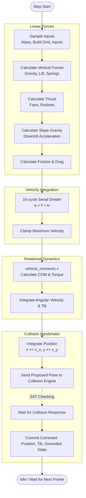
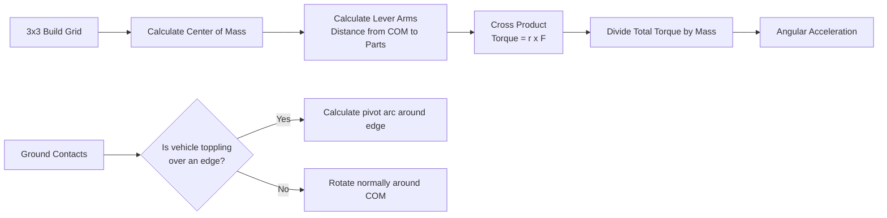

# Bad Piggies FPGA Physics Architecture

The physics engine (`physics_engine.v`) is a rigid-body solver running in fixed-point arithmetic (Q12.8 format) at 100 MHz. Because the FPGA has strict constraints (no single-cycle divisions, limited multipliers), the engine is built as a sequential Finite State Machine (FSM) that calculates forces, divides by mass, calculates torque, and resolves collisions over multiple clock cycles.

---

## 1. The Physics Pipeline (Execution Flow)

Every update frame, the FSM steps through a strict sequence of calculations before handing the proposed movement to the collision engine.

---

## 2. Force & Velocity Calculation

The engine breaks down forces into horizontal and vertical components, ensuring they are summed sequentially to save logic.

1. **Vertical Base:** Gravity is a hardcoded downward force (`32`). Balloons subtract from this (`-24` each). A spring trigger instantly overrides vertical velocity with an upward impulse (`-512`).
2. **Propulsion:** 
   - **Engines** apply force to wheels touching the ground.
   - **Fans & Rockets** rotate their thrust vectors based on the vehicle's current tilt using pre-calculated trigonometric lookups (`rotation_sin`, `rotation_cos`). Because rockets can be angled, their X/Y force components are accumulated sequentially to avoid instantiating multiple hardware multipliers.
3. **Slope Gravity:** If grounded on a hill, a fraction of gravity is projected horizontally using `net_gravity * slope_factor`.
4. **Mass Division:** Acceleration is $a = F / m$. Because division (`/`) consumes massive FPGA resources, the engine routes total force and total mass through a custom restoring divider (`signed_divider16.v`), which takes 16 clock cycles to produce the acceleration.
5. **Momentum & Friction:** The vehicle's momentum is checked against rolling drag (`wheel_drag`) or scraping drag (`scrape_drag`). Friction can stop the vehicle but will never push it backward.

---

## 3. Moments & Rotational Physics

Rotational physics is offloaded to a dedicated module (`vehicle_moments.v`). 

### Center of Mass (COM)
The 3x3 vehicle grid is scanned. Each part has a specific weight (e.g., Engine = 3, Pig = 2, Wheel = 1). The COM is found by averaging the positions of all active parts weighted by their mass.

### Torque Calculation
For each active fan or rocket, the engine calculates its distance vector (`arm_x`, `arm_y`) from the COM. The thrust vector is crossed with the lever arm to find the torque. The total torque is divided by the mass to determine angular acceleration.

### Edge Pivoting
If the vehicle hangs off a ledge (its COM is past the edge of the supporting terrain), normal free-space rotation is paused. Instead, the engine calculates an orbital arc around the physical contact edge, ensuring the vehicle smoothly topples over the cliff rather than spinning in mid-air.

---

## 4. Terrain & Slope Interaction

The terrain is not perfectly smooth; it is a rasterized bitmap. The physics engine and collision engine (`rotating_map_collision_engine.v`) work together to handle slopes smoothly.

1. **Terrain Probing:** The collision engine uses left and right probes to measure the ground beneath the vehicle.
2. **Gradient Feedback:** It reports the slope back to the physics engine as a `dy/dx` ratio (e.g., Q4.4 format).
3. **Settling & Snapping:**
   - **Alpha-Beta Filter:** To prevent the camera/graphics from jittering vertically as the vehicle moves over 2-pixel staircase terrain, the visual output (`display_y`) is smoothed over time.
   - **Alignment:** When grounded, the physics FSM gently rotates the proposed vehicle tilt towards the measured slope angle (1 step per frame) until it aligns flush with the hill. 
   - **Slope Acceleration:** The measured slope directly drives the "Slope Gravity" horizontal force calculation, causing unpowered vehicles to coast downhill.