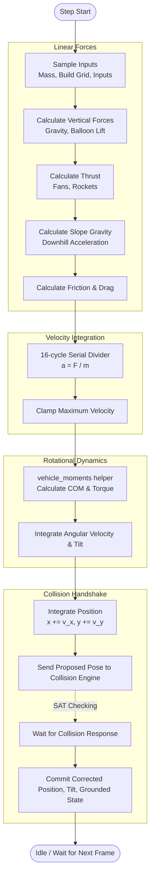
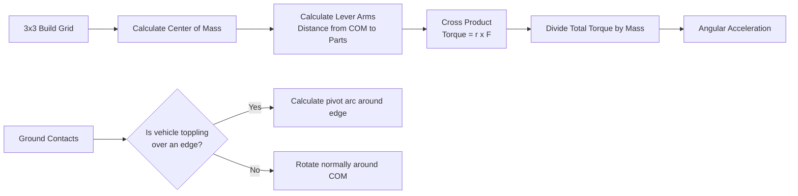

# Bad Piggies FPGA Physics Architecture

The physics engine (`physics_engine.v`) is a rigid-body solver running in fixed-point arithmetic (Q12.8 format) at 100 MHz. Because the FPGA has strict constraints (no single-cycle divisions, limited multipliers), the engine is built as a sequential Finite State Machine (FSM) that calculates forces, divides by mass, calculates torque, and resolves collisions over multiple clock cycles.

---

## 1. The Physics Pipeline (Execution Flow)

Every update frame, the FSM steps through a strict sequence of calculations before handing the proposed movement to the collision engine.

---

## 2. Force & Velocity Calculation

The engine breaks down forces into horizontal and vertical components, ensuring they are summed sequentially to save logic.

1. **Vertical Base:** Gravity adds downward acceleration `32`; each intact balloon subtracts acceleration `24`. The former spring/jump impulse is removed. BTNL is reserved, and legacy `jump_press` ports are inert.
2. **Propulsion:** 
   - **Engines** apply force (`ENGINE_FORCE = 320`) to wheels touching the ground (`+X` forward, or `-X` reverse when `SW15` is ON). The engine starts OFF on every run and is toggled by clicking its cell on the 3×3 run diagram.
   - **Horizontal fans** supply world-horizontal force of `64` per enabled intact fan (`fan_manual_mask[cell]`), pushing left (`-X`) when facing right and right (`+X`) when facing left.
   - **Downward-blowing lift fans** supply world-up force `256` each (`FAN_LIFT_FORCE_SHIFT = 8`). `live_lift_fan_count` supplies the active intact count from `fan_manual_mask`, and the 9-bit `fan_lift_mask` identifies their cells for moments while excluding them from horizontal `fan_balance`.
   - **Rockets** rotate their body-fixed thrust using `rotation_sin` and `rotation_cos` (`ROCKET_FORCE_SHIFT = 10`, force `1024`). Rockets fire once per run when clicked on the 3×3 run diagram or via `BTNR`, accumulating X/Y force components sequentially alongside visual exhaust flames.
3. **Slope Gravity:** Grounded ramp acceleration uses the measured slope and remaining downward acceleration. Fan lift is divided by mass and reduces both slope gravity and the support reaction; net upward lift releases ground support.
4. **Mass Division:** Acceleration is $a = F / m$. Because division (`/`) consumes massive FPGA resources, the engine routes total force and total mass through a custom restoring divider (`signed_divider16.v`), which takes 16 clock cycles to produce the acceleration.
5. **Momentum & Friction:** The vehicle's momentum is checked against rolling drag (`wheel_drag`) or scraping drag (`scrape_drag`). Friction can stop the vehicle but will never push it backward.

---

## 3. Moments & Rotational Physics

Rotational physics uses the `vehicle_moments` module appended to `physics_engine.v`. There is no separate `vehicle_moments.v` design source. COM, force projections and pivot corrections reuse the helper's serial multiplier and divider; fan lift adds no independent multiplier, divider or memory.

### Center of Mass (COM)
The 3x3 vehicle grid is scanned. Each part has a specific weight (e.g., Engine = 3, Pig = 2, Wheel = 1). The COM is found by averaging the positions of all active parts weighted by their mass.

### Torque Calculation
For each active fan or rocket, the engine calculates its distance vector (`arm_x`, `arm_y`) from the COM. Torque is `rx*Fy - ry*Fx`. Thus an off-centre lift fan uses its world-horizontal arm and upward force to turn the body; a centred lift fan supplies lift without torque. The total torque is divided by the mass-scaled inertia to determine angular acceleration. Wheel drive remains translational and supplies no moment.

### Edge Pivoting
If the vehicle is unbalanced over its actual contact span, the engine proposes rotation around the physical contact edge. On ramps the support test uses the terrain normal, not a vertical-only reaction. Airborne rotation uses the COM. Collision checks the complete rotated pose and rejects unsafe turns; angular damping brings unpowered spin toward rest.

---

## 4. Terrain & Slope Interaction

The terrain is not perfectly smooth; it is a rasterized bitmap. The physics engine and collision engine (`rotating_map_collision_engine.v`) work together to handle slopes smoothly.

1. **Terrain Probing:** The collision engine uses left and right probes to measure the ground beneath the vehicle.
2. **Gradient Feedback:** It reports the slope back to the physics engine as a `dy/dx` ratio (e.g., Q4.4 format).
3. **Settling, Anti-Shake & Display Smoothing:**
   - **Sub-Pixel Display Smoothing (`display_x`, `display_y`):** To prevent the camera and vehicle sprites from jittering over 1–2 pixel staircase terrain, `display_x` and `display_y` filter slope stair-steps (`grounded_stair_step`), add a 0.5 px wheel landing bounce (`wheel_landing_bounce`), and render with `Q12.1` half-pixel interpolation in `right_renderer.v`.
   - **Alignment & Stationary Anti-Reversal Lock:** When grounded, the physics FSM steps the proposed vehicle tilt toward the measured slope angle (`11.25°` per step) with 2-sample stationary hysteresis (`held_count == 2'd2`) and an anti-reversal lock (`last_turn_valid`, `unstable_settled_dir`, `stationary_anchor_x_px`) to eliminate 2-state `T <-> T+1` oscillation on slopes.
   - **Slope Acceleration:** The measured slope directly drives the "Slope Gravity" horizontal force calculation, causing unpowered vehicles to coast downhill.

## 5. TNT Explosions, On-Board TNT & Tiered Fall Damage

* **World TNT Crates (`tnt_controller.v`):** Swept-AABB detection between the previous and committed vehicle poses triggers radial distance-squared cell and frame blast masks (`tnt_damage_mask`, `tnt_damage_frame_mask`), applies directional velocity knockback impulses (`tnt_kick_vx`, `tnt_kick_vy`), and launches visual fireball/smoke and debris particles (`scatter_mask`).
* **On-Board TNT Crate:** Placed inside a wood frame from Inventory Page 2 (`LP_PART_FRAME` in `build_grid`). Clicking the TNT cell during `LP_RUN` detonates it in-flight (`onboard_tnt_detonate`), destroying orthogonal neighbor cells/frames (`onboard_tnt_blast_mask`) and applying a directional velocity kick.
* **Tiered Fall-Distance Crash Damage:** Tracks peak airborne height (`fall_peak_y`) to measure landing drop (`fall_distance_q8`). Normal drops are harmless; a **medium fall** (`>= 58 px` on Map 1, `>= 48 px` on Map 2) breaks only the contact row's non-pig contents while preserving wooden frames; a **high fall** (`>= 64 px` on Map 1, `>= 52 px` on Map 2) breaks all non-pig parts and frames while protecting the Pig Pilot.
